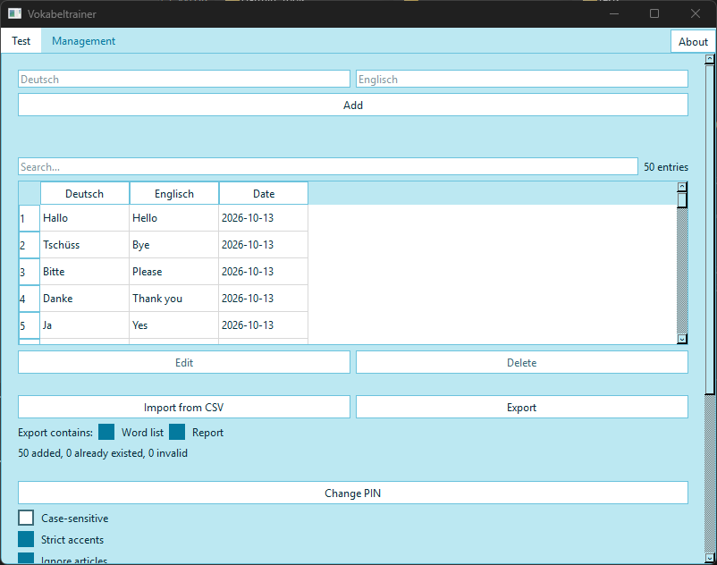
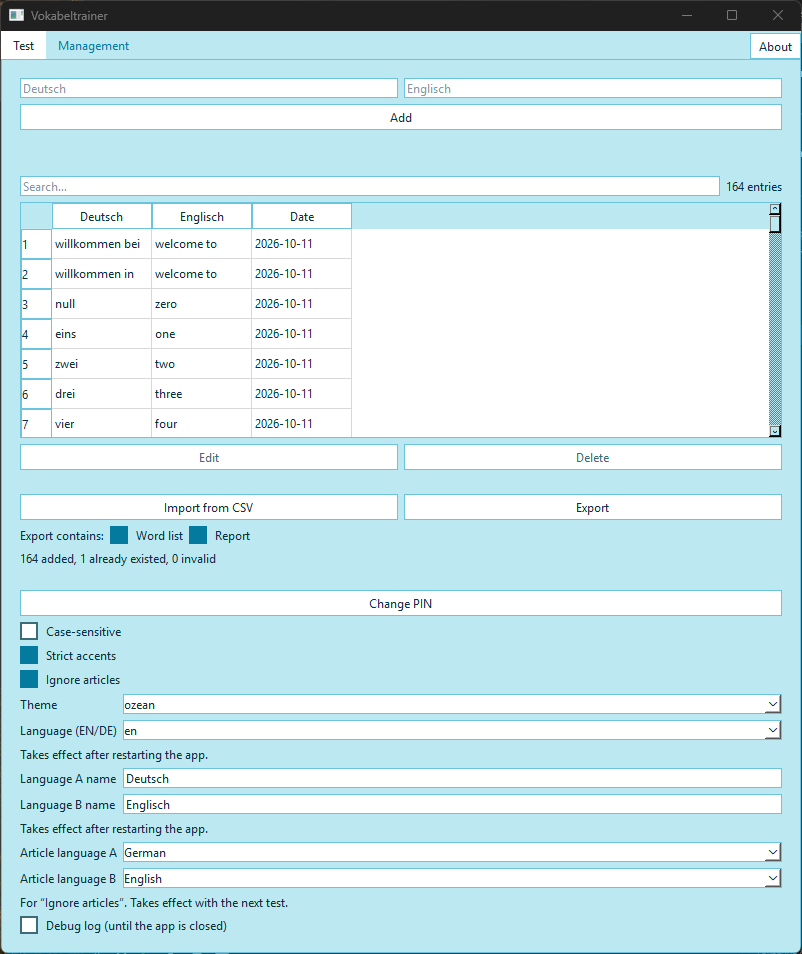
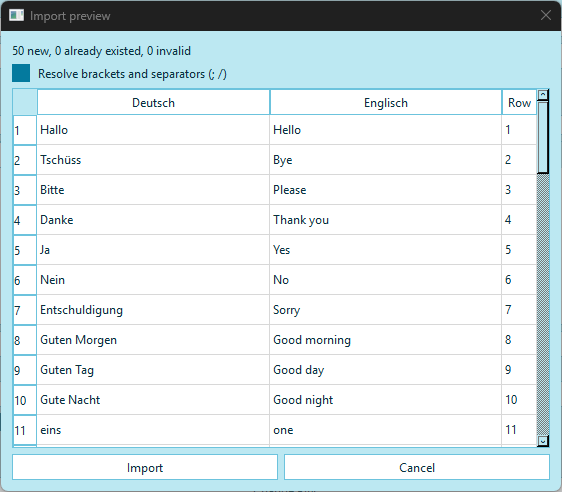
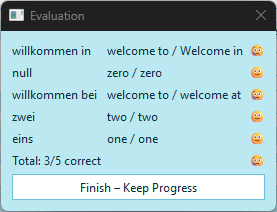
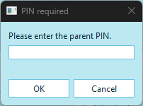
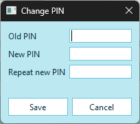

# User Guide — Vocabulary-Trainer

[Deutsch](Bedienungsanleitung.md) · **English**

The Vocabulary-Trainer helps with learning vocabulary. Parents (or a teacher)
look after the word list, the child practises in the test. Everything runs on
your own computer, without internet and without an account.

---

## Contents

1. [Installation and first start](#1-installation-and-first-start)
2. [Language and appearance](#2-language-and-appearance)
3. [Entering words](#3-entering-words)
4. [Importing words from an Excel file](#4-importing-words-from-an-excel-file)
5. [Searching, editing and deleting words](#5-searching-editing-and-deleting-words)
6. [Exporting words and the report](#6-exporting-words-and-the-report)
7. [Taking a test](#7-taking-a-test)
8. [Checking answers](#8-checking-answers)
9. [The overview in the Test tab](#9-the-overview-in-the-test-tab)
10. [PIN, privacy and security](#10-pin-privacy-and-security)
11. [A second child, updates and backups](#11-a-second-child-updates-and-backups)
12. [Troubleshooting](#12-troubleshooting)

---

## 1. Installation and first start

1. Extract `Vocabulary_trainer.zip` to a folder, e.g.
   `Documents\Vocabulary-Trainer`.
2. In the extracted folder, double-click `Vocabulary_trainer.exe`.
3. On first start the app creates the file `config.json` and the folder
   `logs\`. The folder `daten\` (vocabulary) appears with the first saved
   word, `metadaten\` (learning progress) with the first completed test. Do
   not rename or move these files and folders while you use the app.

The app is portable: all data lives in the program folder. You can copy the
whole folder (e.g. to a USB stick, or as a backup).

The app has two areas (tabs at the top): **Test** for the child and
**Management** for the parents. **Management** is protected by a **PIN**. As
long as you have not set your own, the PIN is **`1234`** — please change it
right away (see [section 10](#10-pin-privacy-and-security)).

At the top right of the tab bar there is also an **About** button. It shows
the **version**, the copyright, the licence notice and the link to the source
code — and four buttons under **Documentation** that open the **README** and
this **User Guide** (each in German and English) in a window. It needs no PIN.

This is the **Test** tab:



---

## 2. Language and appearance

In the **Management** tab, at the bottom, in the settings:

- **Language (EN/DE):** `en` or `de`. The change takes effect after you
  restart the app.
- **Theme:** ozean, sonne, dschungel, beere, pink or nacht. The change takes
  effect immediately.
- **Language A name / Language B name:** the two languages you learn are shown
  with names of your choice, e.g. *Deutsch* and *Englisch*. This also takes
  effect after a restart.
- **Article language A / B:** see [section 8](#8-checking-answers).

---

## 3. Entering words

The **Management** tab (after entering the PIN) gathers everything for the
parents: the entry fields at the top, below them the word list with a search
field, then import and export, and the settings at the very bottom.



The entry fields at the top:

1. Type the word into the first field (e.g. *Haus*) — the field shows the name
   of the first language.
2. Type the translation into the second field (e.g. *house*).
3. Click **Add**.

The new word appears in the table straight away. A word that already exists is
not added twice.

### Several correct answers

If you enter the same word with two different translations, both count as
correct. Example:

| Deutsch | Englisch |
|---|---|
| groß | big |
| groß | large |

In the test, *large* is then accepted when *big* is asked for. If the child
types the other solution, a follow-up question appears: *"Correct, but not the
one I'm looking for — there's a second answer. What is it?"* That way the
child learns both meanings.

> **Note:** A word with two **different meanings** (e.g. *Schloss* = *castle*
> and *Schloss* = *lock*) is linked in exactly the same way. That is
> intentional. Pay attention to the follow-up question in such cases.

---

## 4. Importing words from an Excel file

Instead of typing words one by one, you can take many words at once from an
Excel sheet.

### What the file looks like

The first row holds the column headers, for example:

| Deutsch | Englisch | Datum |
|---|---|---|
| Haus | house | 2026-09-01 |
| Hund | dog | 2026-09-01 |
| groß | big | 2026-09-02 |

- The headers may be the names of the languages (as above, as entered in the
  settings) or the technical names `Sprache_A` / `Sprache_B`. Which column
  comes first does not matter.
- The **Datum** column is optional and, for hand-made files, **not read**: the
  date of the import is always used. The date decides which words count as
  "new".

### How to save it

In Excel: **File → Save As → file type "CSV UTF-8 (Comma delimited)"** (in a
German Excel: *CSV UTF-8 (durch Trennzeichen getrennt)*). It is important to
choose the option **with UTF-8** so that umlauts arrive correctly. Whether the
file uses a semicolon or a comma as separator, the app detects by itself.

### How to import

In the **Management** tab click **Import from CSV** and choose the file. The
**Import preview** opens. It shows what would happen — **nothing is saved yet**:

- at the top: how many entries are new, how many already exist and how many
  are invalid (with the row numbers, counted below the header row: row 1 is
  the first word row)
- below it the list of new entries, with the row number from the file



**Import** saves exactly what is shown. **Cancel** saves nothing. You cannot
deselect single rows. If there is nothing new, no window appears, only the
result line.

- Existing words are **never overwritten**.
- Duplicate rows are skipped.
- Only new words are added, so you can safely import a changed file again.

### Several meanings in one cell

Books and lists from the internet often put several meanings into one cell
(`dein/deine; euer/eure`) or add hints (`Herr (Anrede)`). The app resolves
this on import, **one meaning per entry**:

| In the file | Becomes |
|---|---|
| `pink; rosa` or `dein/deine` | one entry per meaning |
| `I'm (= I am)` | two entries: `I'm` and `I am` |
| `Herr (Anrede)`, `welcome (to)` | `Herr`, `welcome` — the hint is dropped |
| `Sei(d) still.` | `Sei still.` and `Seid still.` |
| `life, lives` | stays one entry — the **comma never splits** |

The preview has a tick box **Resolve brackets and separators (; /)**, **on**
by default. If you switch it off, the cells are imported exactly as they are
in the file — useful if an entry really contains a slash (`und/oder`). A line
at the top of the preview tells you how many rows were resolved ("39 rows were
turned into 97 pairs.").

A hint in brackets is **lost** this way (it will no longer show in the test).

**Please check:** If a row has several meanings on **both** sides (e.g.
`it's (= it is)` and `er/sie/es ist`), all combinations are formed — some may
be pairs that do not belong together. The preview names such rows ("Please
check … rows 54"). Cancel, split that row into single rows in the file and
import again.

The app's own export file (see section 6) is **never** split when you read it
back in.

### Preparing words from photos of a school book with an AI assistant

An AI assistant (e.g. Gemini or ChatGPT) can turn photos of a book's
vocabulary pages into a ready file. If you tell it exactly what the file
should look like, you save yourself the tidying: one meaning per row, no
brackets. This is how:

1. Copy the text below and give it to the AI together with the photos. In the
   second line, adjust the two languages.
2. Copy the AI's answer (only the text in the code block) into a text file and
   save it with the extension `.csv` (UTF-8 encoding).
3. Open the file in Excel once and check rows with `???` — something on the
   photo could not be read there.
4. Import as described above.

The app also copes with files that were **not** prepared this way (see
above), but a list with one meaning per row needs no double-checking.

```text
You get photos of vocabulary pages from a school book. Turn them into a CSV file
for the vocabulary trainer. Language A = German, language B = English.  (adjust)

Format:
- Header line exactly: Sprache_A;Sprache_B
- Semicolon as separator, UTF-8 encoding, one vocabulary meaning per line.
- Output only the CSV text in a code block, with no explanation before or after.

Rules:
1. If a word has several translations, write a separate line for EACH and repeat
   the word: "pink;pink" and "pink;rosa" (not "pink;pink; rosa").
2. No slashes and no multiple entries in one cell. "mein/meine" become two lines;
   "er/sie/es ist" becomes three lines: "er ist", "sie ist", "es ist".
3. No brackets. If a bracket holds a long form ("I'm (= I am)"), write both forms
   as separate lines. Leave out pure hints such as (Anrede) or (auch Pl.).
   If the bracket is attached to the word ("Sei(d) still"), write both variants
   as lines.
4. Keep the article with nouns as in the book ("der Waschbär"), unless the book
   gives none.
5. Keep punctuation in sentences and phrases ("Thank you.", "Auf Wiedersehen.").
6. If two forms belong together as a pair (singular/plural: "life, lives" /
   "das Leben, die Leben"), make two lines: "life;das Leben" and "lives;die Leben".
7. Leave out headings, page numbers, example sentences and learning tips.
8. If something is illegible, write ??? in its place instead of guessing.
9. If a cell contains a semicolon or quotation marks, put the cell in quotation marks.
```

---

## 5. Searching, editing and deleting words

In the **Management** tab there is a **search field** above the table
(*Search…*). While you type, only the rows that contain the text in either
language stay visible — upper/lower case and accents do not matter. Next to it
it says "x of y", or, without a search, the number of entries.

You cannot type into the table directly. Click a row (it is highlighted), and
the **Edit** and **Delete** buttons become active.

- **Edit:** opens a small window with both texts of the row. After correcting,
  click **Save**. The correction applies to the word in **all** rows where it
  occurs (also for linked words), and the learning progress of the word is
  kept.
- **Delete:** only the chosen row is removed (other rows with the same word
  stay). You are asked first and must confirm.

---

## 6. Exporting words and the report

In the **Management** tab, next to **Import from CSV**, there is the
**Export** button, and below it two tick boxes (**Export contains:**):

- **Word list** — all words of the list in the technical format. For backups,
  for passing on, or for importing again later (also into another instance).
- **Report** — a readable report of the learning progress, to open in Excel.

Both boxes are ticked by default. After clicking **Export**, choose a
**folder**. Each ticked item becomes its own file, with date and time in the
name (nothing is overwritten):

- `wortliste_<list>_<date>_<time>.csv`
- `report_<date>_<time>.csv`

Afterwards the app opens the folder.

The **report** holds the overall figures at the top (completed and aborted
tests, test period, questions answered, different words tested, mistakes,
accuracy, test time) and below it a table per word (tests, mistakes, accuracy,
date of the last mistake) with the **words with the most mistakes first**. Time
and period count only completed tests. A word that was deleted after a test
appears as "(removed)" in the table so that the sums add up. Separator and
decimal mark follow the language of the interface (English: comma and point;
German: semicolon and comma), so that Excel splits the columns correctly. If
the report appears in a single column in your Excel, switch the app language
to match your Excel (settings, then restart) or use *Data → Text to columns*.

> **Note:** The report contains the words **in clear text** and lies wherever
> you saved it. It is meant for the parents.

---

## 7. Taking a test

In the **Test** tab (for the child, no PIN) you first set what to practise:

| Setting | Meaning |
|---|---|
| **List** (dropdown, top) | Which vocabulary list is used |
| **Direction** | From the first to the second language or the other way round (labelled with the language names) |
| **Question Count** | How many words are asked: any number from 1 to 999 (default: 20) |
| **Newest words only** | Only the most recently entered words; the number next to it says how many "newest" means (default: 25) |
| **Words with errors only** | Only words that had mistakes before |

Then click **Start Test**.

### How it works

1. The word is shown. Type the translation.
2. Click **Check**. The app shows "Correct!" or "Wrong. The correct answer
   was: …".
3. **Next** goes on to the next word.
4. At the end the **Evaluation** appears: how many words were right and which
   were wrong.

Close the evaluation with **Finish – Keep Progress** (the window's X closes it
just the same). **Only then is the session saved.**



> **Important:** If the test is ended with **Cancel** or via the window's X, **nothing**
> is saved (it only counts as "aborted").

### How the words are chosen

Exactly as many words are asked as **Question Count** says (all of them, if
there are fewer words). For this the app takes the words that are most urgent,
in this order:

1. words that have never been tested
2. the most recently entered ones
3. words with a high error rate
4. words with many mistakes
5. words that have not been tested for a long time

The words are asked in random order. If you set only **few** questions and
have already practised every word, you mainly get the words with a high error
rate — that is intentional.

---

## 8. Checking answers

In the **Management** tab, in the settings, you decide how strictly answers
are checked. A change applies to the next answer:

- **Case-sensitive:** off by default. *Haus* and *haus* then count as equal.
- **Strict accents:** on by default. *año* and *ano* count as different.
- **Ignore articles:** off by default. If on, a **leading** article is
  ignored when comparing: *Haus* counts as correct for *das Haus*.

So that "Ignore articles" knows the right articles, there are two dropdowns,
**Article language A** and **Article language B**. You can choose **German,
English, Spanish, French** or **none** (default: A = German, B = English). The
language that the child is currently **typing** counts: for direction A → B
that of B, for B → A that of A. This applies from the next test. The lists are
deliberately short:

| Language | Articles |
|---|---|
| German | der, die, das |
| English | the |
| Spanish | el, la, los, las |
| French | le, la, les |

Not recognised are e.g. *a/an*, *un/una*, *l'* and *ein/eine*.

Spaces at the start and end and double spaces are always ignored.

The settings apply to all tests and should not be changed all the time, so
that the results stay comparable.

---

## 9. The overview in the Test tab

At the top of the **Test** tab an overview shows the progress. It updates by
itself after every completed test:

- **Tests completed** — number of completed sessions
- **Correct answers** — right answers out of all answers given
- **Last test** — date of the last completed session
- **Day streak** (with record) — on how many days in a row there was practice
- **Error-free streak** (with record) — how many answers in a row were correct
- **Mastered words** — words answered correctly 10 times in a row
- **This week (last week)** — number of tests compared

The overview is visible in the **Test** tab without a PIN. It is meant for the
child and is there to motivate. Not visible to the child are the single words
with their mistakes and the report — both are behind the PIN in
**Management**, or in the export.

---

## 10. PIN, privacy and security

### The PIN

- The **Management** tab is protected by a **PIN**: the first time you open it,
  the app asks for it. Once entered correctly, the area stays open **until you
  close the app**. With a wrong PIN, the tab does not open.
- As long as no PIN of your own is set, it is **`1234`**.
- **Change PIN:** in **Management**, in the settings, click **Change PIN** —
  old PIN, new PIN (at least 4 characters), repeat new PIN.
- The PIN is only an **access code** and belongs to the instance (it is stored
  in `config.json` as an unreadable hash). So every child has their own PIN.
  It is **not** the key for the learning data: **a forgotten PIN never costs
  data.**

 

**Forgotten PIN — reset to `1234`:**

1. Close the app.
2. Open the file `config.json` in the program folder with a text editor
   (right-click → *Open with* → *Notepad*).
3. Find the line with `"pin_hash"`. It looks like this:
   `"pin_hash": "…long string of characters…",`
4. Replace the string, including the quotation marks, with `null`, so that it
   reads: `"pin_hash": null,` (keep the comma at the end, if there was one).
5. Save, start the app. The PIN is `1234` again — set a new one right away.

### What is protected — and what is not

- **No connection to the internet.** The app sends no data. The one exception:
  a link to the project's pages on GitHub (in the **About** window or in the
  documentation opened there) opens your browser, **only if you click it** —
  the app itself sends nothing in doing so. It does not open other addresses.
- **Vocabulary** is stored as a normal CSV file in the folder `daten\vokabeln\`
  and can be opened with Excel.
- **Learning progress** is stored encrypted in `metadaten\tracking.enc`. The
  file cannot be read or changed with a text editor. The encryption does
  **not** depend on the PIN.
- The protection is deliberately simple: it keeps a curious child away from
  Management and from the learning statistics. It does not protect against
  someone who breaks into the app itself or has full administrator rights on
  the PC.

### Log and error messages

- The folder `logs\` holds `app.log`, a technical log (start, import, export,
  wrong PIN entries without the PIN). It contains **no vocabulary in clear
  text** and stays limited to a few MB.
- In **Management**, in the settings, there is the tick box **Debug log (until
  the app is closed)**. It writes more detail when an error should be
  reproduced on purpose, and only applies until the app is closed.
- If an unexpected error occurs, a window **Unexpected error** appears. The app
  keeps running. The error report is saved under
  `%LOCALAPPDATA%\Vokabeltrainer\crash` (the path is shown in the window) —
  **not** in the program folder. The words in it are made unrecognisable. You
  can attach this file and `logs\app.log` when you report a problem in the
  project's issues: <https://github.com/Wewoc/Vocabulary-Trainer/issues> (please
  state the version, see the **About** button).

---

## 11. A second child, updates and backups

Every child gets their **own folder** with their own vocabulary list, their
own learning progress and their own PIN. To set one up:

1. Start `update.exe` from the extracted folder.
2. Choose a new, empty target folder.
3. Start the app from the new folder.

`update.exe` asks for the target folder (*target folder*) and reports "Done."
at the end. If it shows "Is the target app still running?", the app is still
open — close it and try again.

> **Important:** Do **not** copy one child's folder as a template for the next.
> It contains the first child's identifier, progress and PIN. A copy of the
> folder is meant as a **backup** (see below), not as a second instance.

**Updating an existing installation:** the same procedure with the folder of
the existing installation. Only the program files and the documentation are
replaced. Vocabulary, learning progress, settings, PIN and log are kept.

> **Important:** Close the app first. If it is still running, the update
> stops with a message.

**Backup:** close the app and copy the **whole folder** (e.g. to a USB stick).
At the very least back up `daten\` and `metadaten\tracking.enc` — the words and
the progress. To restore, copy the folder back to its old place.

**Words between two computers** are transferred with **Export** (tick *Word
list*) on one and **Import from CSV** on the other. The progress does not
travel with it, only the words.

---

## 12. Troubleshooting

| Problem | What to do |
|---|---|
| The app does not start | Check that all files from the ZIP were extracted, in particular the folder `_internal`. |
| Management does not open | The PIN is wrong. Forgotten? See section 10, "Forgotten PIN". |
| The import says "Could not read the file." | Save the file in Excel as **CSV UTF-8** and try again. |
| Umlauts are shown wrongly | Choose the same save option: **CSV UTF-8**. |
| An imported word is missing | Check the column headers. Do they match the language names or `Sprache_A`/`Sprache_B`? Rows without text in one of the two columns are skipped as invalid. |
| The import says "0 added" | All words already exist, or the rows are invalid. The numbers in the message show which applies. |
| Rows in the preview differ from the file | The app resolved brackets and separators (section 4). The tick box in the preview switches that off. |
| A word I entered is missing from the test | With **Newest words only** or **Words with errors only** not all words are asked. **Question Count** also limits the test. |
| A window "Unexpected error" appears | The app keeps running. Keep the file named in the window (folder `crash`) and `logs\app.log`, and attach them when you report it in the issues (<https://github.com/Wewoc/Vocabulary-Trainer/issues>). |
| The texts are in the wrong language | Change the language (`de`/`en`) in the settings and restart the app. |
| The update says the app is still running | Close the app and start the update again. |
| Which version do I have? | Click **About** at the top right. Include the version when you report a problem. |
